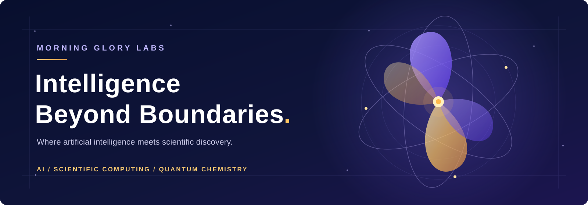
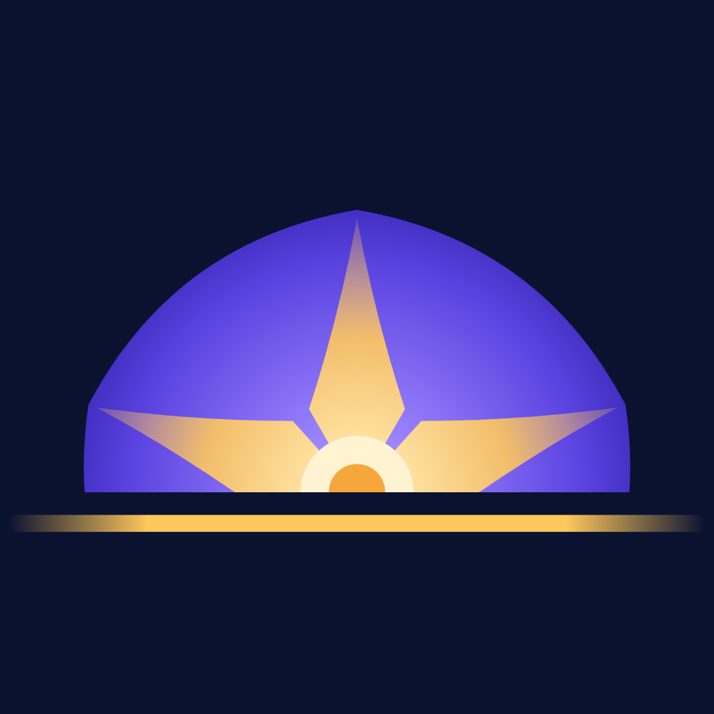

# Morning Glory · 晨光科技

**Intelligence Beyond Boundaries.** 智能无界，探索未知。 
*From Artificial Intelligence to Scientific Discovery.* 从人工智能到科学发现。

[MolAstria](https://molastria.com) · [About](https://molastria.com/about/) · Toronto, Canada

---

Morning Glory is a Toronto-based emerging technology brand being developed under **16513778 Canada Inc.**, a Canadian federal corporation, with a focus on AI applications, intelligent automation, data analytics and scientific computing.

Our long-term vision is to bridge artificial intelligence, computational science and advanced technology, building practical tools and intelligent systems that support scientific discovery, industrial innovation and data-driven decisions. We are especially interested in computational chemistry, quantum chemistry, scientific machine learning and high-performance computing.

Morning Glory（晨光科技 / 晨光实验室）是 16513778 Canada Inc.（加拿大联邦注册公司，多伦多）发展的科技品牌，关注 AI 应用、智能自动化、数据科学与科学计算，长期希望参与 AI 与基础科学的交叉研究。

## What is live today · 已上线

### [MolAstria](https://molastria.com) — AI & Scientific Computing

A navigator for computational-chemistry research: unified resource search, a resource relationship network, a 20-chapter bilingual handbook, database catalog, journal submission guides, a comparison of 27 scientific foundation models, an AI lab, a preprint radar, a playground with a browser-based quantum-chemistry calculator, and Windows/macOS desktop apps.

计算化学研究导航：资源搜索、资源关系网、20 章中英双语讲解手册、数据库目录、期刊投稿指南、27 个科学大模型对比、AI 实验室、预印本雷达、浏览器里的量子化学计算器，以及 Win/Mac 桌面版。

Source: [FelixJiashengFu/chem-research-molastria](https://github.com/FelixJiashengFu/chem-research-molastria)

MolAstria is currently our only public product. 
目前对外的产品只有 MolAstria。

## Four directions · 四个方向

| | Direction | 方向 | Status |
| --- | --- | --- | --- |
| 01 | **AI Application Development** — AI agents, LLM applications, multi-agent systems | AI 应用开发 | Partly in MolAstria (AI lab, AI assistant, chemdb-agent MCP server) |
| 02 | **Intelligent Automation** — workflow automation, AI assistants, API integration | 智能自动化 | Used inside MolAstria (weekly data refresh, weekly digest); no external service yet |
| 03 | **Data Science & Predictive Modeling** — analytics, statistical modeling, ML, prediction | 数据科学与预测建模 | Partly in MolAstria (merged catalog, network queries, ML potentials) |
| 04 | **AI for Science & Computational Research** — computational & quantum chemistry, scientific ML, HPC | AI 科学研究与计算科学 | **Live** in MolAstria |

## Roadmap · 路线图

This is a plan, not a description of the present. 这是规划，不是现状。

1. **AI Technology Company** — AI applications, automation, software. *(planned · 规划中)*
2. **Scientific Computing Company** — scientific computing, computational chemistry, research AI. *(MolAstria is the start · MolAstria 是起点)*
3. **AI for Fundamental Science** — new frameworks connecting AI with fundamental science, mathematics and physics. *(planned · 规划中)*

The structure above describes the brand we are building. It does not mean that these departments, teams or research capabilities have all been formally established. 
以上是规划中的品牌与业务架构，不代表这些部门、团队或科研能力已经全部正式成立。
